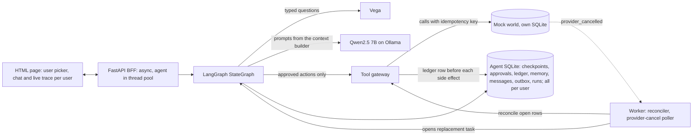
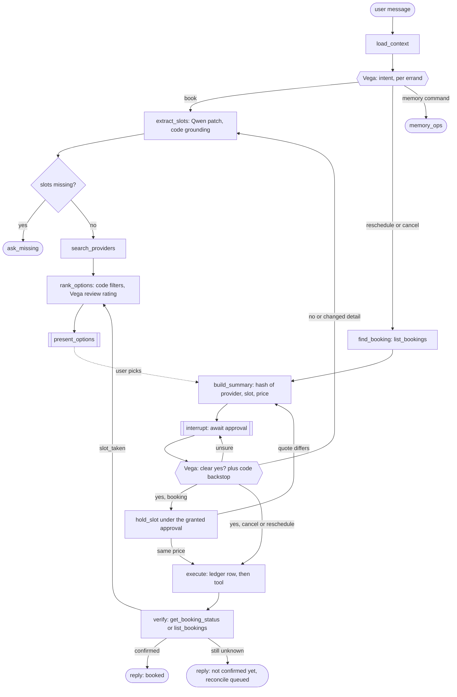
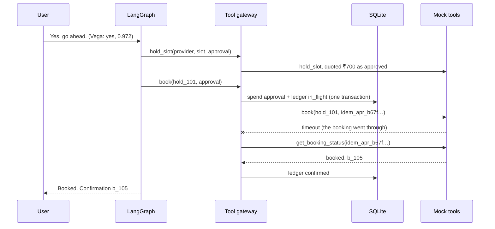

# Errand Agent: design note

**Principle.** The LLM proposes; code decides. Qwen returns only schema-bound proposals (slot
patches, a pick, a memory command, small talk). Vega answers typed questions inside nodes (intent,
clear yes, review quality, injection flag). No model output and no tool text can cause a side effect.



**State model.** One LangGraph `StateGraph` per thread (`user_id:session_id`), checkpointed after every step,
with explicit JSON state (`phase`, `slots` and their sources, `options`, `hold`, `approval`, queued
errands). A message resumes the thread at its `interrupt()` or at `load_context`. Edges are data,
pinned by a test. Every node has an error boundary, so any failure ends with a clear reply and saved
state. Budgets are per run and hard, timed on the agent's clock: 6 Qwen calls, 40 Vega decisions,
12 tool calls and 30 s, with 5 calls and 8 s reserved for execute and verify. Each tool call's
client timeout is the run's remaining time.



**Approval enforcement.** Code renders the summary from tool data and opens a pending approval with
`sha256(action, provider, slot, price, booking_id)`. A grant needs a confident Vega yes, a reply
with no hedge, shrug, claim of approval or order to the agent (code), and the hash the user saw.
Only then is the slot held: the gateway refuses `hold_slot` without a granted approval for that
provider and slot. A quote that differs voids the approval and asks again. For `book` the gateway
re-derives the material from its own records (the hold, the live booking); without a granted,
unspent match it raises `ApprovalRequired` and never calls the tool.

**Idempotency and recovery.** One transaction spends the approval and opens a ledger row
(`in_flight`, key `idem_<approval>`). Retries reuse the key, and the provider dedupes on it. A
timeout, a crash or an unreadable reply is settled from the source of truth with bounded backoff,
retrying under the same key if nothing happened. Only a `confirmed` row may say "Booked". The
reconciler settles open rows at startup and on every worker tick.



From `traces/timeout_after_success.jsonl` (the live confirmation run, fields trimmed):

```text
#3  decision   approval: yes @ 0.972                  the user's own words, read by Vega
#4  approval   granted   apr_b67f6e583955d227          hash matched the summary shown
#6  tool.call  hold_slot  approval=apr_b67f…           held only now, under the grant
#8  approval   consumed  ┐ one transaction, before the call
#9  ledger     in_flight ┘ idem_apr_b67f6e583955d227
#10 tool.call  book(hold_101, idem_apr_…) 2003 ms timeout   outcome unknown, not "failed"
#13 tool.call  get_booking_status(idem_apr_…) 1 ms     ask the source of truth
#14 ledger     confirmed b_105                         only now may the reply say "Booked"
#15 claim      book b_105 via reply                    what eval invariant 3 checks
```

**Users and concurrency.** `user_id` and `session_id` are required, never defaulted. Every agent
table carries `user_id`, and the database layer refuses any query on them that doesn't filter by it
(the reconciler's sweep is the one declared cross-user scan); another user's run, approval or
booking reads as absent. The mock world claims a slot with one conditional `UPDATE ... WHERE status
= 'free'` and checks the row count: of two users approving one slot, one books and the other gets
`slot_taken` and fresh options. SQLite runs in WAL; spending an approval and opening its ledger row
is one `BEGIN IMMEDIATE` transaction, and unique indexes enforce one key, one booking. Blocking work
runs in the thread pool, a per-thread lock orders a double tab, and Vega decides under its lock,
keeping nothing between calls.

**Memory and context.** Explicit facts are active at once; inferred ones wait for a yes/no.
Corrections supersede; forgetting tombstones the key and scrubs its values from history. Per call,
the builder takes active facts filtered in SQL by key and service, an extractive summary and recent
turns (replies that list memory excluded) under a 6,000-token cap, and traces a manifest. Tool text
reaches a model only sanitized inside `<untrusted>`; slots change only from the user's words.

**Observability and evaluation.** One JSONL trace per run: transitions with slot sources, Vega
decisions, Qwen calls, tool calls, manifests, approvals, ledger and claims, shown live beside the
chat. 55 offline scenarios use scripted or recorded Qwen and Vega and a fault-injecting mock world.
They check outcomes and seven invariants (the seventh: a run touches only its user's data), each
shown to fail on a broken agent; `make test` runs them. Eight concurrency scenarios fire requests at
once through the ASGI app, with a turnstile pinning who claims first; `make eval-stress` replays
them under 20 world seeds and fails on any flake.

**Trade-offs.** *LangGraph plus a ledger:* checkpoints resume conversations, but truth lives in the
ledger and the provider. *Vega in nodes:* decisions sit beside their effect, at the cost of a 35 s
startup and GPU sharing with Ollama. *Approval before hold:* nothing is reserved without consent,
at the cost of a second yes when a quote changes. *SQLite, no RAG:* transactional and exact.
